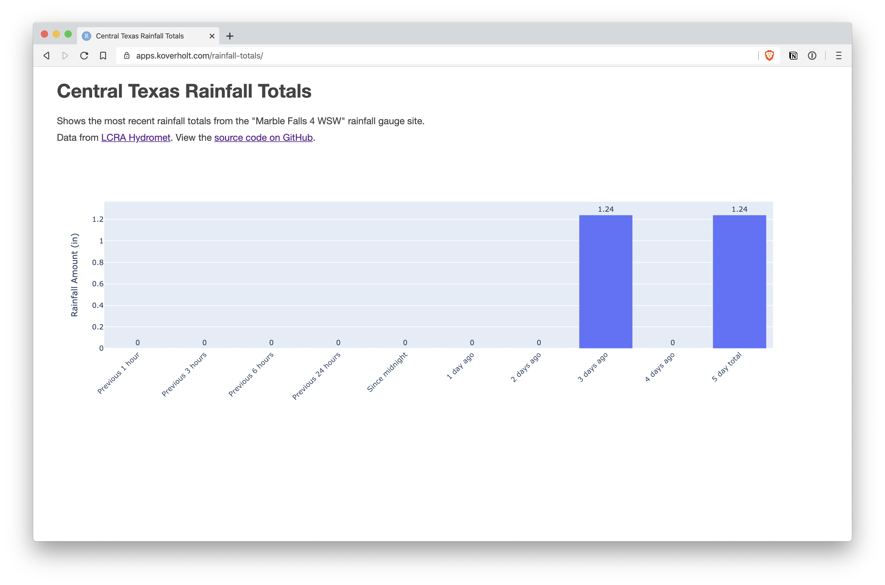

# rainfall-data

Display rainfall data in Central Texas



Data from https://hydromet.lcra.org/

## Deployment

Frontend (`site/`) deploys automatically to Cloudflare Pages (`rainfall.koverholt.com`) on push to `main`.

Backend (`src/`) deploys automatically to Cloud Run via Cloud Build trigger (`rainfall-data`) on push to `main`, or manually via:

```
gcloud run deploy rainfall-data --source src/ --region us-central1 --allow-unauthenticated
```
